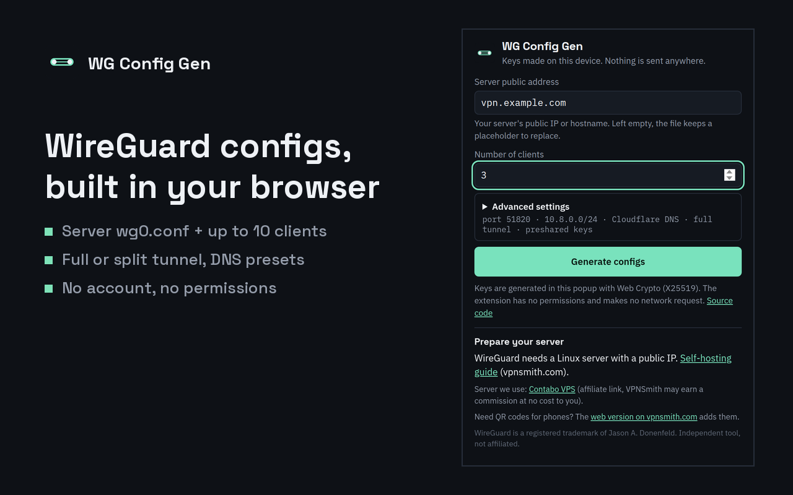
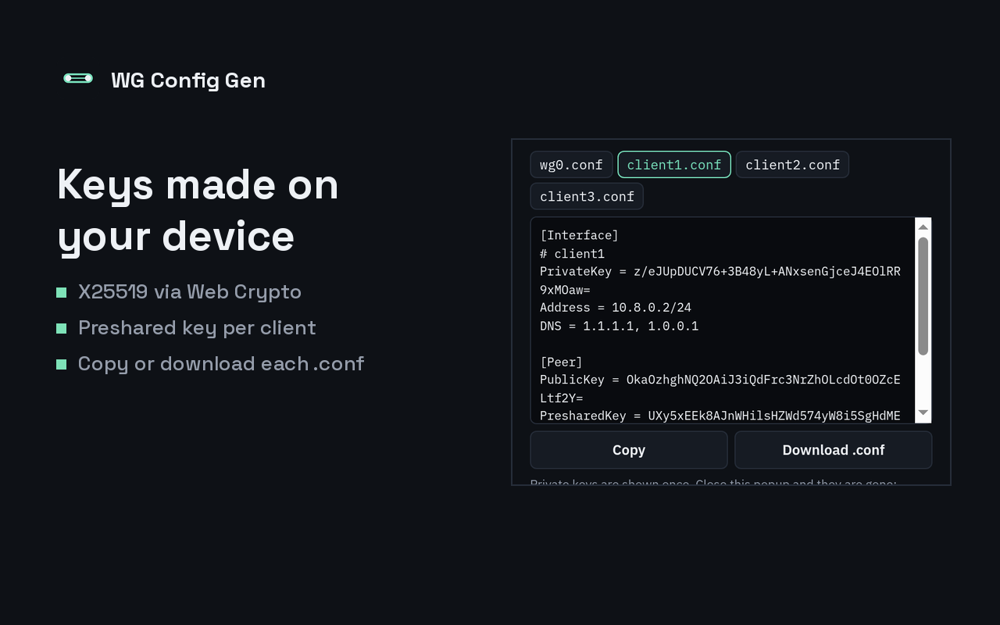

# Config Generator for WireGuard (Chrome extension)

Build a WireGuard server file (`wg0.conf`) and 1 to 10 client files in your browser toolbar. Keys are generated **on your device** with Web Crypto X25519: the extension asks for **zero permissions** and makes **zero network calls**, so your private keys never leave the popup.



## What it does

- Server keypair plus 1 to 10 client keypairs, each with an optional preshared key (same PSK written on both sides).
- Endpoint, listen port, VPN subnet and DNS fields.
- Full tunnel (`0.0.0.0/0, ::/0`) or split tunnel (only the VPN subnet).
- Copy or download every file: `wg0.conf` for the server, `client1.conf`, `client2.conf`... for the devices.
- Interface in English (store name and summary also in French, Spanish, German, Portuguese and Italian).



## Install

The Chrome Web Store listing is in review. Until it is live, you can load the release build yourself:

1. Download `wg-config-gen-1.0.0.zip` from the [latest release](https://github.com/ricco020/wg-config-gen-extension/releases/latest) and unzip it.
2. Open `chrome://extensions`, switch on **Developer mode** (top right).
3. Click **Load unpacked** and pick the unzipped folder.

Requires Chrome 133 or later (X25519 in Web Crypto). Works in other Chromium browsers of the same version.

## Check the keys yourself

Every public key in the output is derived from its private key. To verify one with Python:

```python
import base64
from cryptography.hazmat.primitives.asymmetric.x25519 import X25519PrivateKey
priv = X25519PrivateKey.from_private_bytes(base64.b64decode("<PrivateKey from the file>"))
print(base64.b64encode(priv.public_key().public_bytes_raw()).decode())  # must equal the PublicKey line
```

## No server yet?

The files are useless without a machine to run `wg0.conf`. Two guides from the publisher:

- [Self-host a WireGuard VPN on a small VPS, step by step](https://www.vpnsmith.com/en/blog/self-host-vpn-contabo-wireguard-2026?utm_source=github&utm_medium=wg-config-gen&utm_content=readme)
- [Full web generator with QR codes for phones](https://www.vpnsmith.com/en/tools/wireguard-config-generator?utm_source=github&utm_medium=wg-config-gen&utm_content=readme)

The guide uses a Contabo VPS. If you rent one through [this affiliate link](https://www.vpnsmith.com/go/contabo-vps-2y?src=ext-wg-gh), VPNSmith earns a commission at no extra cost to you. Any Linux VPS with a public IPv4 works the same way.

## Privacy

No data collected, no analytics, no remote code. See [PRIVACY.md](PRIVACY.md).

## For developers

- `wg.js`: key generation and config building (pure functions).
- `popup.*`: UI. Outbound links carry `utm_source=chrome-extension&utm_medium=wg-config-gen`; the Contabo link uses `/go/contabo-vps-2y?src=ext-wg-gen` (disclosed in the popup).
- `tools/pack.py`: zip for the Chrome Web Store into `dist/`.
- Tested on 30/10/2026 in Chromium with 1.0.0: 3 files generated, every public key matches its private key (Python `cryptography`), preshared keys identical on both sides, 0 page error.

"WireGuard" is a registered trademark of Jason A. Donenfeld. This project is not affiliated with or endorsed by the WireGuard project.
